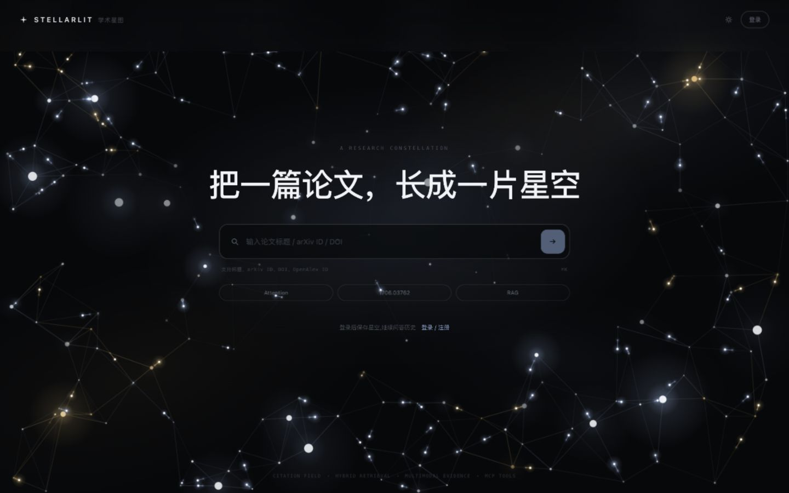
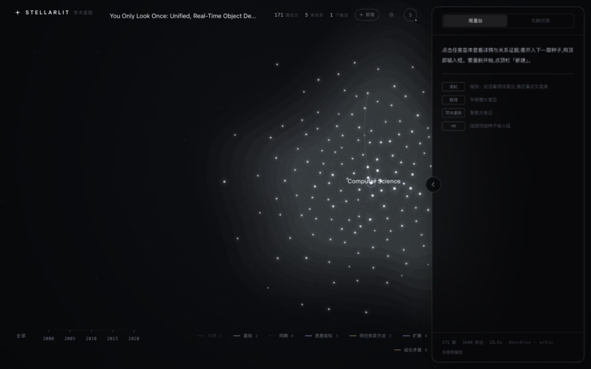
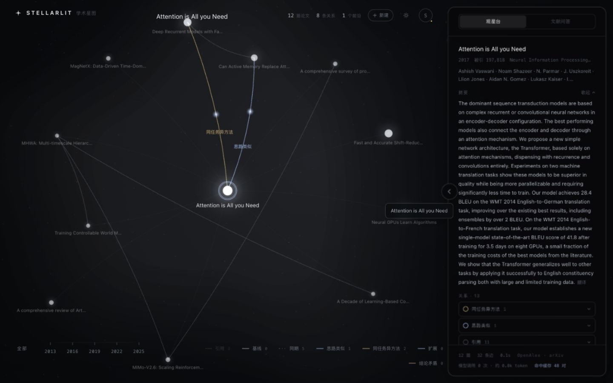
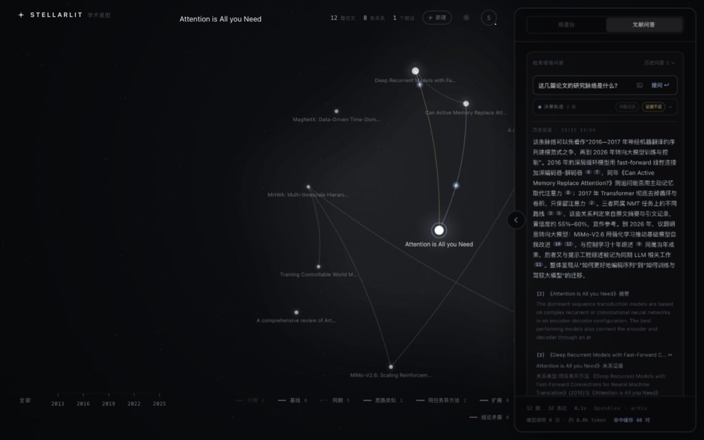
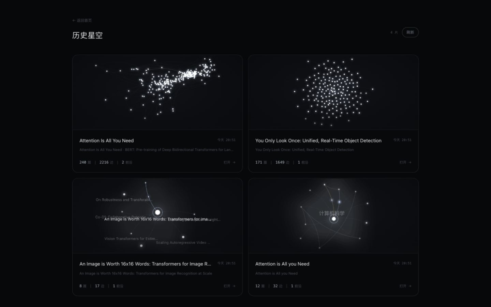
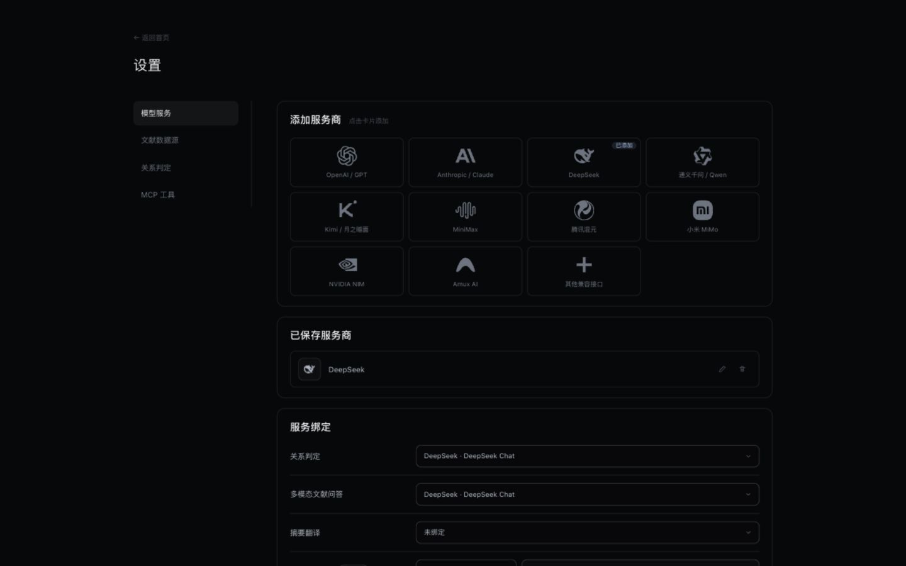
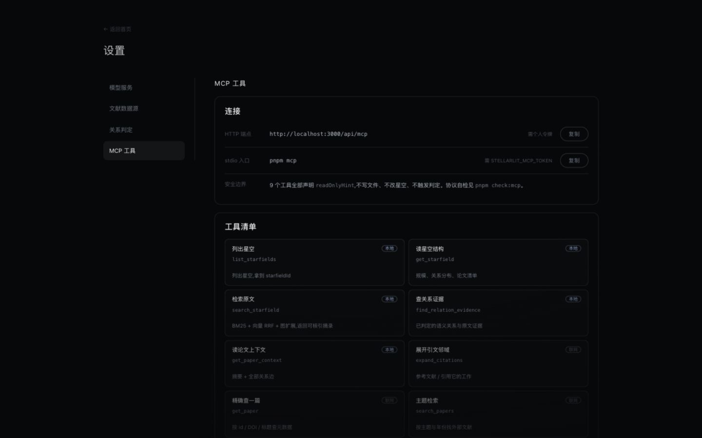
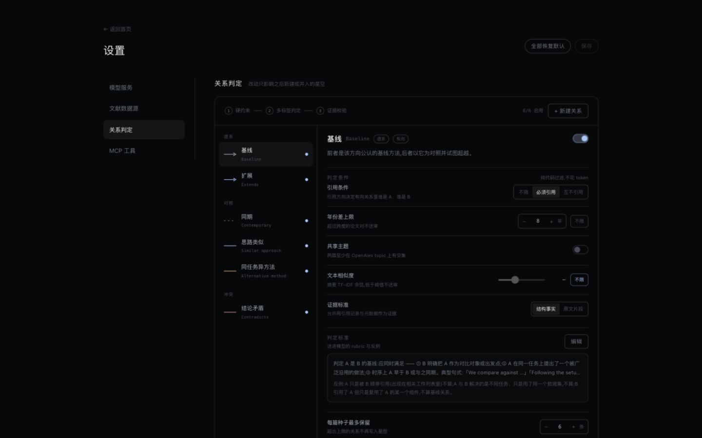
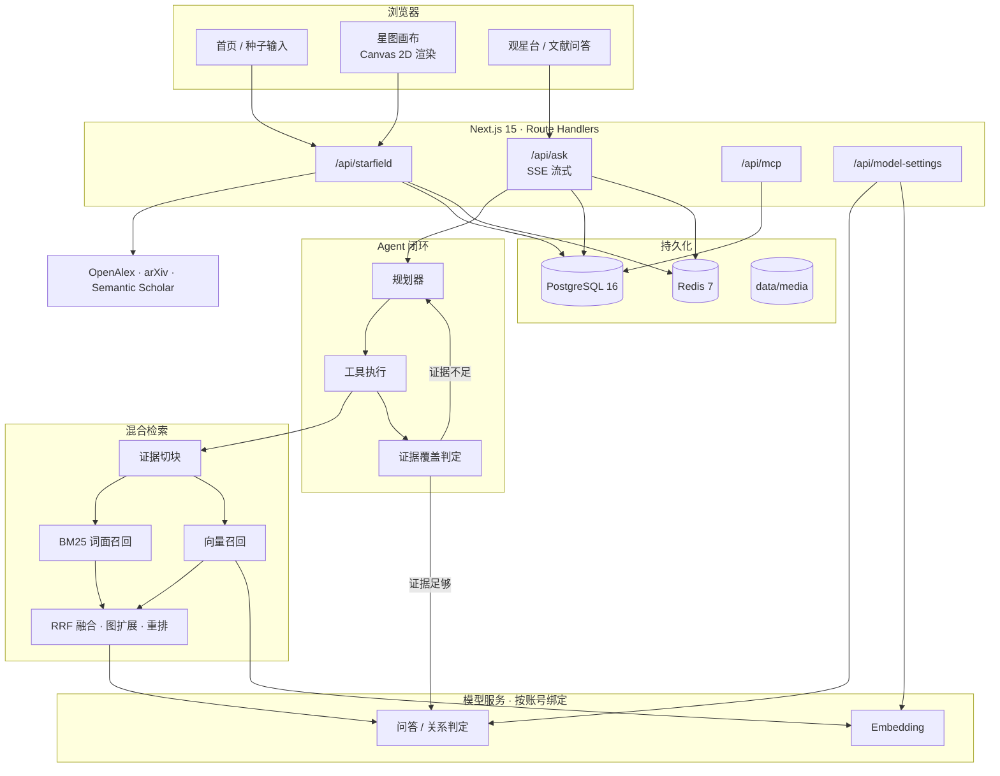
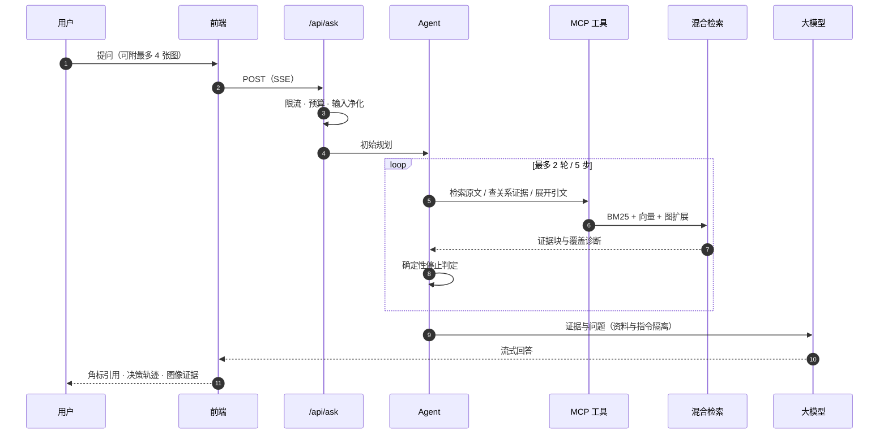

<p align="center">
  
</p>

<h1 align="center">StellarLit · 论文星图</h1>

<p align="center"><strong>把一篇论文，长成一片星空。</strong></p>

<p align="center">
输入标题、arXiv ID 或 DOI，沿着引用与语义关系长出一张可缩放、可追问的研究星图。<br/>
每一条关系都带原文证据，每一次回答都能点回出处。
</p>

<p align="center">
  
  
  
  
  
  
  
</p>

<p align="center">
  <a href="https://stellarlit.wenshi.xin:8443"><strong>在线演示</strong></a> ·
  <a href="#快速开始">快速开始</a> ·
  <a href="#架构">架构</a> ·
  <a href="docs/架构设计.md">设计文档</a> ·
  <a href="docs/知识图谱模型.md">图谱模型</a> ·
  <a href="docs/部署指南.md">部署指南</a>
</p>

---

## 一、这是什么

StellarLit 是一个面向科研阅读的**关系型文献图谱**。论文是星，关系是引力线：输入一篇种子论文，
系统从 OpenAlex 与 arXiv 抓取引文邻域，再用大模型判定论文之间的语义关系，最后组织成一张
可缩放、可点选、可追问的星图。

它想解决的不是「找不到论文」，而是**「看得见引用，却看不见为什么相关」**：

- **关系可质疑**：六类语义关系都有判定标准与硬约束，每条边都必须带原文片段作为证据。
- **星空会长大**：同一片星空可以反复并入新种子，节点坐标持久，老星体不会被重新洗牌。
- **图谱能对话**：基于摘要与关系证据的检索增强问答，回答里的角标可以点回原文；也支持上传图表提问。

> 2026 第九届「传智杯」全国大学生数智创新与 AI 应用大赛 · AI WEB 网页开发挑战赛
> 赛道编号 10037 · 选题方向：RAG 知识问答系统（学术文献助手）

## 二、核心能力

| 能力 | 实现 |
| --- | --- |
| **大模型集成** | OpenAI 兼容接口，多厂商可切换；结构化 JSON 判定 + SSE 流式回答；超时、解析失败与额度不足都有降级路径 |
| **Agent 工作流** | 规划 → MCP 工具调用 → 证据覆盖判定 → 补查或停止，最多 2 轮 / 5 步；每个决策都在界面留下轨迹 |
| **RAG** | 摘要与关系原文切块；BM25 + 向量双路召回；RRF 融合、图结构扩展、意图重排与证据阈值 |
| **多模态** | 最多 4 张图；视觉模型抽取 OCR、表格、图表序列、关键数值与归一化区域坐标；证据可点击定位 |
| **AI 安全** | 输入净化、资料与指令隔离、IP 限流与并发上限、每账号每日 token 预算、输出兜底 |
| **MCP** | 9 个只读工具，stdio 与 HTTP 双入口，个人访问令牌，外部 Agent 可自行读取星空与检索原文 |

## 三、在线演示与界面

| 项目 | 内容 |
| --- | --- |
| 演示地址 | <https://stellarlit.wenshi.xin:8443> |
| 体验账号 | 见完整作品文件 `2026传智杯/Web/【评审必读】在线演示与体验账号.txt` |
| 可用能力 | 已绑定 DeepSeek Flash（支持视觉），可直接新建星空、检索问答与上传图表提问 |

> 体验账号与密码不在公开 README 中展示，请在提交的完整作品文件中查看
> `2026传智杯/Web/【评审必读】在线演示与体验账号.txt`。
> 演示账号仅用于赛事评审，请勿修改密码或删除已有星空。


<table>
<tr>
<td width="50%"><br/><sub><b>星图画布</b>：语义缩放，拉远是领域星云，推近是论文星体</sub></td>
<td width="50%"><br/><sub><b>关系证据</b>：点开星体即可看到摘要、关系类型与原文依据</sub></td>
</tr>
<tr>
<td width="50%"><br/><sub><b>文献问答</b>：流式回答、角标引用、决策轨迹与证据卡</sub></td>
<td width="50%"><br/><sub><b>历史星空</b>：真实星图缩略预览，一键回到上次的研究现场</sub></td>
</tr>
<tr>
<td width="50%"><br/><sub><b>模型服务</b>：按账号绑定多厂商账户，分别选择判定 / 问答 / 翻译模型</sub></td>
<td width="50%"><br/><sub><b>MCP 工具</b>：只读工具清单与接入配置，外部 Agent 即插即用</sub></td>
</tr>
<tr>
<td colspan="2"><br/><sub><b>关系判定</b>：六类关系各自有引用约束、年份差、相似度与证据标准，支持自定义多标签关系</sub></td>
</tr>
</table>

## 四、架构

整体分四层：浏览器负责渲染与交互，Route Handlers 负责鉴权、限流与流式输出，
Agent 与 RAG 负责「查什么、够不够」，数据层负责持久化与跨实例缓存。



**分层不是口号。** 代码依赖严格单向：`types → lib → features → components → app`，
服务端密钥只存在于 `src/server`。任何反向依赖都会被 ESLint 的 `no-restricted-imports` 直接报错，
不靠自觉。图谱分成三层：L1 结构层（引用 / 作者 / 发表）、L2 语义层（六类关系 + 证据链）、
L3 派生层（社区 / 领域 / 潜在连接），详见 [知识图谱模型](docs/知识图谱模型.md)。

### 一次问答如何发生



停止判断不交给模型：覆盖率达到阈值、轮次耗尽或工具无新增证据时，由确定性规则给出停止理由。
模型只决定「下一步查什么」，这样轨迹才能复现，也才能在界面上解释「为什么停」。

## 五、技术栈

| 层 | 选型 | 为什么 |
| --- | --- | --- |
| 框架 | Next.js 15（App Router）+ React 19 + TypeScript strict | 页面与 Route Handlers 同仓；AI 接入层不额外起服务 |
| 样式 | Tailwind CSS v4（CSS-first `@theme`） | 设计令牌即 CSS 变量，换主题 = 换一套变量 |
| 状态 | Zustand | 只有跨组件共享的状态才进 store |
| 渲染 | Canvas 2D 自写管线 | 数百至上千节点下比 SVG / DOM 稳；绘制是纯函数，可脱离 React 测试 |
| AI | OpenAI 兼容接口 | 不绑定单一厂商；模型、密钥、绑定均按账号隔离 |
| 数据库 | PostgreSQL 16（`pg` + JSONB） | 多账号并发写、事务与行级隔离 |
| 缓存 | Redis 7（`ioredis`） | TTL、跨实例共享、上游 host 节流；不可用时自动降级 |
| 数据 | OpenAlex / arXiv / Semantic Scholar | 免费且有官方 API；OpenAlex 使用账号注册邮箱进入礼貌池 |

## 六、快速开始

### Docker（推荐）

```bash
git clone https://github.com/Xuezhihengg/stellarlit.git
cd stellarlit
cp .env.docker.example .env
openssl rand -hex 24      # 填入 POSTGRES_PASSWORD
openssl rand -base64 32   # 填入 ENCRYPTION_KEY
docker compose up -d --build
```

打开 `http://localhost:3000`，注册第一个账号即可。首个账号会接管仓库自带的演示星空。
模型服务、向量模型与 Semantic Scholar Key 全部在登录后的「设置」里按账号绑定，
系统不读取部署级模型密钥。

### 本地开发

需要 Node.js 24+、PostgreSQL 16+、Redis 7+。

```bash
createdb stellarlit
redis-cli ping                # 应返回 PONG
pnpm install
cp .env.example .env.local
pnpm key:generate             # 输出写入 ENCRYPTION_KEY
pnpm dev                      # http://localhost:3000
```

```bash
pnpm check                    # 类型、规范与 13 组领域自检
pnpm build && pnpm start      # 生产构建
pnpm cleanup                  # 手动执行一次缓存与会话清理
```

### 环境变量

完整模板见 [`.env.example`](.env.example) 与 [`.env.docker.example`](.env.docker.example)。

| 变量 | 必填 | 默认 | 说明 |
| --- | --- | --- | --- |
| `DATABASE_URL` | 否 | `postgresql://localhost:5432/stellarlit` | PostgreSQL 连接串；首次启动自动建表 |
| `REDIS_URL` | 建议 | `redis://localhost:6379` | 不可用时自动降级为直接读源 |
| `ENCRYPTION_KEY` | 生产必填 | — | 32 字节主密钥，AES-256-GCM 加密厂商 API Key；丢失不可恢复 |
| `SAFETY_DAILY_TOKEN_BUDGET` | 否 | `400000` | 每账号每日 token 预算，与账号页、顶栏用量联动 |
| `MAINTENANCE_TOKEN` | 生产必填 | — | `/api/maintenance/cleanup` 的 Bearer 令牌 |
| `MAINTENANCE_INTERVAL_MIN` | 否 | `360` | 后台清理间隔（分钟） |
| `STELLARLIT_DATA_DIR` | 否 | `./data` | 媒体对象与磁盘缓存目录 |
| `REDIS_PREFIX` | 否 | `stellarlit` | 多实例共用 Redis 时的命名空间 |
| `STELLARLIT_MCP_TOKEN` | 否 | — | 仅 stdio 入口 `pnpm mcp` 需要；HTTP 入口用设置页生成的个人令牌 |

缓存容量、TTL、星空体积上限等调优项见 `.env.example` 注释。Compose 额外使用
`POSTGRES_PASSWORD`、`APP_BIND`、`APP_PORT`。完整依赖清单见 [`package.json`](package.json)
与 `pnpm-lock.yaml`。

## 七、目录结构

```text
src/
├─ app/                  路由与页面组装（唯一允许接触全部层的地方）
├─ components/
│  ├─ star-map/          画布：星空渲染管线
│  ├─ shell/             界面外壳：顶栏、观星台、底部
│  └─ ui/                纯展示组件（不认识业务，不认识状态）
├─ features/             业务域：按功能切，不按技术切
├─ hooks/                应用级 hook
├─ lib/
│  ├─ graph/             图算法：纯函数，无 IO，可单测
│  └─ design/            设计令牌
├─ server/
│  ├─ agent/             规划、执行、覆盖判定与停止
│  ├─ rag/               切块、召回、融合、重排、图像索引
│  ├─ mcp/               只读工具与协议实现
│  ├─ safety/            限流、预算、输入净化
│  └─ db/                连接池、迁移与各领域仓储
├─ stores/               Zustand
└─ types/                数据契约
docs/                    架构、图谱模型、部署指南与截图
scripts/                 自检、探针、密钥迁移与 MCP 服务
```

## 八、质量保障

`pnpm check` 是一条可重复的验收线，覆盖 15 项：

```text
typecheck · lint · tokens · label · rag · multimodal · providers · relations
mcp · agent · safety · crypto · cache · db · auth
```

其中 `rag` / `agent` / `safety` / `mcp` 等脚本直接调用生产代码路径，验证检索融合、停止判定、
提示词隔离与协议自检，而不是另写一份「测试专用实现」。仓库保留分阶段提交历史（80+ 次），
每个能力都能追溯到引入它的那次改动。关系判定出问题时，可以用探针复现模型实际看到的提示词：

```bash
pnpm probe baseline 3
```

## 九、部署

生产环境只需要 Docker 24+ 与 Compose v2，应用、PostgreSQL、Redis 一起编排：

```bash
cp .env.docker.example .env
docker compose up -d --build
```

反向代理、HTTPS、备份恢复、定时清理与故障排查见 [部署指南](docs/部署指南.md)。
核心提醒：SSE 必须关闭反代缓冲；`ENCRYPTION_KEY`、数据库与 `./data` 必须一起备份。

## 十、已知限制

- **语义证据目前到摘要与关系原文级别**，尚未按章节对 arXiv 全文切块；接入全文后引用可以精确到章节与字符偏移。
- **「同期」在枢纽型种子上通常为空**：它要求两篇互不引用，而高被引论文的邻域几乎都引用了它，这是定义决定的。
- **没有模型时只保留结构关系**：基线与扩展依赖引用结构，同任务异方法依赖
主题重叠；需要读摘要的判定会明确标注为启发式，而不是编造结论。
- **多模态当前覆盖文本与图像**，语音与视频尚未接入，已在路线图中。

## 十一、团队

**西安交通大学 · 白白BAB · 研究生组**<br/>
指导教师：白秀秀

| 成员 | 角色 |
| --- | --- |
| 薛志恒 | 队长 |
| 张子桦 | 队员 |
| 陈林涛 | 队员 |

2026 第九届「传智杯」全国大学生数智创新与 AI 应用大赛 · AI WEB 网页开发挑战赛 · 赛道 10037。

## 十二、文档

| 文档 | 内容 |
| --- | --- |
| [架构设计](docs/架构设计.md) | 分层、边界、数据流与关键取舍 |
| [知识图谱模型](docs/知识图谱模型.md) | 三层图谱、六类关系、证据链与置信度 |
| [前端工程规范](docs/前端工程规范.md) | 目录约定、依赖方向、组件与样式规范 |
| [部署指南](docs/部署指南.md) | Docker、反向代理、HTTPS、备份与排障 |
| [参赛提交清单](docs/参赛提交清单.md) | 材料核对、评分项对照与演示脚本 |

---

<p align="center"><sub>把文献调研，从「读列表」变成「看星空」。</sub></p>
